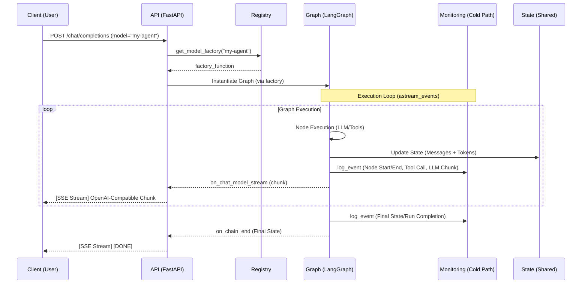

# Architecture Reference: Multi-Agent Streaming API

This document serves as the official architectural reference for the **Flow-Agent-API**. It describes the current system design, which is built to facilitate complex, multi-agent workflows using **LangGraph** and **FastAPI**, providing an OpenAI-compatible interface with real-time streaming and hybrid observability.

---

## 1. Architectural Pillars

The system is built upon four foundational pillars that enable high-performance agentic workflows.

### A. Model Registry & Orchestration
The system treats complex LangGraph workflows as "models." 
- **Dynamic Registration**: Workflows are registered in `src/api/registry.py` using a factory pattern. This allows the API to instantiate the correct graph instance at runtime based on the user's request.
- **Abstraction**: The complexity of flows, tool calls, and conditions is abstracted away, allowing the client to interact with a multi-agent graph as if it were a standard LLM model.

### B. Real-Time Streaming Engine
To provide a "live" experience, the system uses a **Continuous-Stream** model rather than a traditional request-response model.
- **Event-Driven**: Using LangGraph's `astream_events`, the system captures granular lifecycle events (LLM streaming, tool calls, node transitions).
- **Streaming Translation**: The `StreamingTranslator` (`src/api/streaming_translator.py`) intercepts these events and translates them into OpenAI-compatible Server-Sent Events (SSE).
- **Rich Content**: The stream includes not just text, but also "reasoning/thinking" content and structured tool-call information in real-time.

### C. Hybrid Observability
The system implements a two-tier monitoring strategy to balance user experience with deep debugging capabilities.
- **Hot Path (Client Feedback)**: Immediate, lightweight updates (e.g., "Agent X is thinking...") are streamed directly to the user via the API.
- **Cold Path (Deep Analysis)**: Every execution is meticulously recorded in the `monitoring_runs/` directory. This includes `meta.json`, `state.json`, and `events.jsonl`, allowing for post-hoc analysis and debugging without adding latency to the live request.
- **Automated Tracing**: The `observe_node` decorator handles the automatic capture of node lifecycles, metrics, and errors.

### D. State & Token Aggregation
A unified state management system ensures consistency across multiple agent handoffs.
- **Shared State**: Agents communicate through a shared state object (e.g., `MultiAgentState`).
- **Automatic Token Aggregation**: Instead of manually tracking usage, the system uses a **Reducer function** (`sum_reducer`) within the state definition to automatically sum up `total_tokens` from every node interaction.

---

## 2. Communication Flow

The following diagram illustrates the lifecycle of a single user request, from the initial API call to the final monitoring persistence.



---

## 3. Demonstration Models (Examples)

The following graphs are provided as reference implementations to demonstrate the framework's capabilities. They are not the primary product, but rather "test drivers" for the orchestration engine.

| Model ID | Description | Focus |
| :--- | :--- | :--- |
| `pure-chat` | A basic, linear workflow. | Demonstrates standard request-response logic. |
| `profile-management` | A multi-step stateful workflow. | Demonstrates complex state transitions and handoffs. |
| `profile-maintenance` | A specialized maintenance agent. | Demonstrates task-specific orchestration. |
| `anki` | An extensible agent for Anki integration. | Demonstrates how to expand existing tools (like Anki addons) with LLM reasoning and external tools (web search, etc.). |

---

## 4. Developer Guide: Creating a New Model

To implement a new agentic workflow and expose it as a model, follow these steps.

### Step 1: Configuration
Update `src/config/config.json` to include any necessary new components:
- Add new **MCP servers** if required.
- Add or modify **LLM profiles** as needed.
*Note: If adding a new MCP server, create a corresponding `mcp_client.py` in `src/tools/`.*

### Step 2: Directory Structure
Create a new directory for your graph under `src/graphs/<graph_name>/` following this pattern:
```text
src/graphs/graph_name/
├── agents/        # Agent definitions and system prompts
├── nodes/         # Individual node implementations
├── state.py       # Defines the graph state (including reducers)
└── graph.py        # Defines the LangGraph workflow (the orchestrator)
```

### Step 3: Implementation Standards
- **State Management**: In `state.py`, define properties to store initialized MCP clients so they are accessible to any node via the state.
- **MCP Initialization**: Implement an `mcp_initializer` node for every required MCP client. This node is responsible for initializing the client and saving it into the graph state.
- **Node Standard**: Every node implementation must:
    - Import `node_wrapper`.
    - Use the `observe_node()` decorator to enable automated lifecycle monitoring.
    - Import `monitoring_writer.py` if custom telemetry is required.
- **Registration**: Register your new graph in `src/api/registry.py` to make it discoverable.

```python
# Example Registration in src/api/registry.py

async def my_new_graph_factory():
    return create_my_new_graph()

registry.register_model("my-new-model", my_new_graph_factory)
```

---

## 5. Future Roadmap

The roadmap focuses on the evolution of the **Orchestration Framework** rather than specific agent types.

*   **Standardized HITL Plumbing**: Implementation of a robust "Pause/Resume" mechanism for Human-in-the-Loop interactions. The framework handles the state suspension and API signaling, while the individual graph defines the context and approval content.
*   **Automated Model Discovery (Plug-and-Play)**: Transitioning towards a "Zero-Config" registry where the framework automatically detects, validates, and registers new workflows based on directory structure and metadata.
*   **Modular & Compliant Memory Service**: A centralized service providing long-term semantic memory. It will support a "Connector-based" architecture (allowing users to choose between SQLite, Chroma, Pinecone, etc.) and prioritize "Privacy-by-Design" (GDPR/Data-Anonymization compliance).
*   **Automated Quality Assurance (QA)**: Tools for testing and validating agentic logic, ensuring reliability through automated evaluation of tool-call accuracy and state transitions.
*   **Distributed Orchestration**: Enabling the transfer of complex business processes into agentic flows by supporting distributed execution across a decentralized mesh of nodes.

---

## 6. Summary of Key Components

| Component | Responsibility |
| :--- | :--- |
| `src/api/registry.py` | Manages the mapping between model IDs and graph factories. |
| `src/api/streaming_translator.py` | Converts LangGraph events into OpenAI-compatible SSE streams. |
| `src/shared/states.py` | Defines shared states and token aggregation logic. |
| `src/shared/monitoring_writer.py` | Handles file-based persistence of execution logs and state. |
| `observe_node` decorator | Automatically traces node execution for the monitoring system. |
