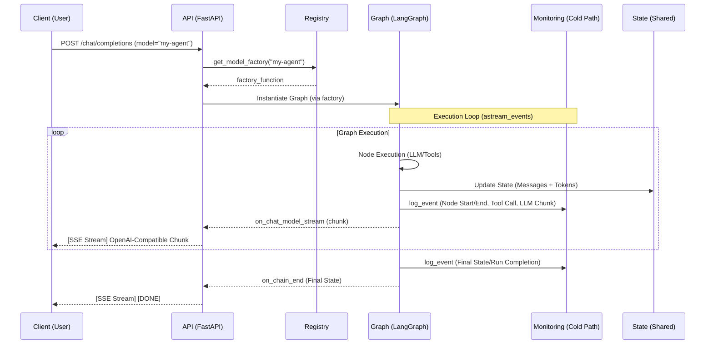
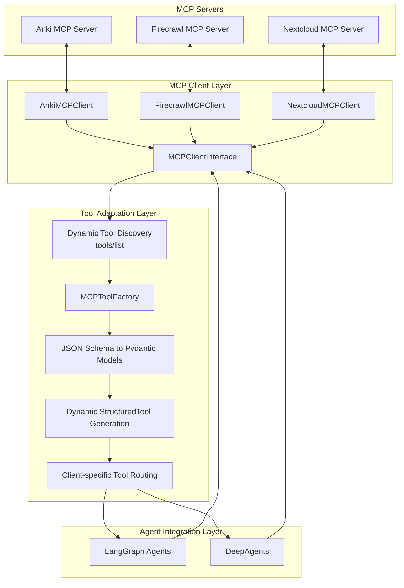
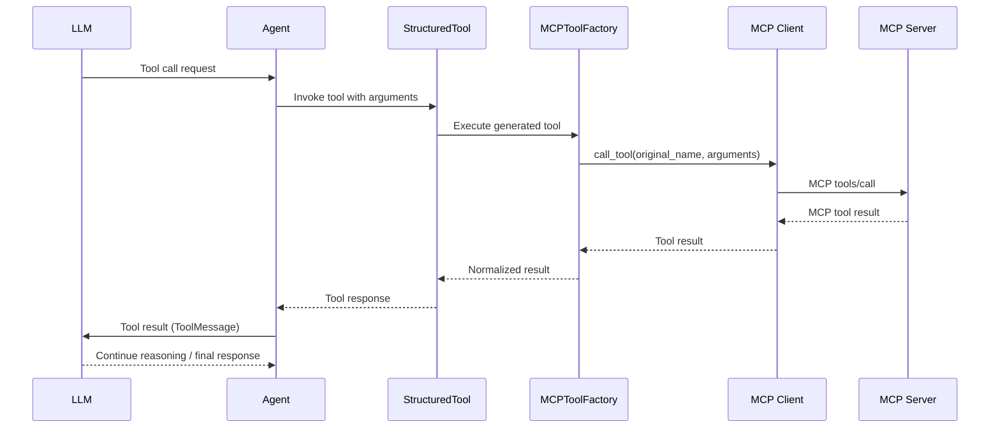

# Architecture Reference: Multi-Agent Streaming API

This document serves as the official architectural reference for the **Flow-Agent-API**. It describes the current system design, which is built to facilitate complex, multi-agent workflows using **LangGraph** and **FastAPI**, providing an OpenAI-compatible interface with real-time streaming and hybrid observability.

---

## 1. Architectural Pillars

The system is built upon four foundational pillars that enable high-performance agentic workflows.

### A. Model Registry & Orchestration
The system treats complex LangGraph workflows as "models." 
- **Dynamic Registration**: Workflows are registered in `src/api/registry.py` using a factory pattern. This allows the API to instantiate the correct graph instance at runtime based on the user's request.
- **Abstraction**: The complexity of flows, tool calls, and conditions is abstracted away, allowing the client to interact with a multi-agent graph as if it were a standard LLM model.

### B. Real-Time Streaming Engine
To provide a "live" experience, the system uses a **Continuous-Stream** model rather than a traditional request-response model.
- **Event-Driven**: Using LangGraph's `astream_events`, the system captures granular lifecycle events (LLM streaming, tool calls, node transitions).
- **Streaming Translation**: The `StreamingTranslator` (`src/api/streaming_translator.py`) intercepts these events and translates them into OpenAI-compatible Server-Sent Events (SSE).
- **Rich Content**: The stream includes not just text, but also "reasoning/thinking" content and structured tool-call information in real-time.

### C. Hybrid Observability
The system implements a two-tier monitoring strategy to balance user experience with deep debugging capabilities.
- **Hot Path (Client Feedback)**: Immediate, lightweight updates (e.g., "Agent X is thinking...") are streamed directly to the user via the API.
- **Cold Path (Deep Analysis)**: Every execution is meticulously recorded in the `monitoring_runs/` directory. This includes `meta.json`, `state.json`, and `events.jsonl`, allowing for post-hoc analysis and debugging without adding latency to the live request.
- **Automated Tracing**: The `observe_node` decorator handles the automatic capture of node lifecycles, metrics, and errors.

### D. State & Token Aggregation
A unified state management system ensures consistency across multiple agent handoffs.
- **Shared State**: Agents communicate through a shared state object (e.g., `MultiAgentState`).
- **Automatic Token Aggregation**: Instead of manually tracking usage, the system uses a **Reducer function** (`sum_reducer`) within the state definition to automatically sum up `total_tokens` from every node interaction.

---

## 2. Communication Flow

The following diagram illustrates the lifecycle of a single user request, from the initial API call to the final monitoring persistence.



---

## 3. Demonstration Models (Examples)

The following graphs are provided as reference implementations to demonstrate the framework's capabilities. They are not the primary product, but rather "test drivers" for the orchestration engine.

| Model ID | Description | Focus |
| :--- | :--- | :--- |
| `pure-chat` | A basic, linear workflow. | Demonstrates standard request-response logic. |
| `profile-management` | A multi-step stateful workflow. | Demonstrates complex state transitions and handoffs. |
| `profile-maintenance` | A specialized maintenance agent. | Demonstrates task-specific orchestration. |
| `anki` | An extensible agent for Anki integration. | Demonstrates how to expand existing tools (like Anki addons) with LLM reasoning and external tools (web search, etc.). |

---

## 4. Developer Guide: Creating a New Model

To implement a new agentic workflow and expose it as a model, follow these steps.

### Step 1: Configuration
Update `src/config/config.json` to include any necessary new components:
- Add new **MCP servers** if required.
- Add or modify **LLM profiles** as needed.
*Note: If adding a new MCP server, create a corresponding `mcp_client.py` in `src/tools/`.*

### Step 2: Directory Structure
Create a new directory for your graph under `src/graphs/<graph_name>/` following this pattern:
```text
src/graphs/graph_name/
├── agents/        # Agent definitions and system prompts
├── nodes/         # Individual node implementations
├── state.py       # Defines the graph state (including reducers)
└── graph.py        # Defines the LangGraph workflow (the orchestrator)
```

### Step 3: Implementation Standards
- **State Management**: In `state.py`, define properties to store initialized MCP clients so they are accessible to any node via the state.
- **MCP Initialization**: Implement an `mcp_initializer` node for every required MCP client. This node is responsible for initializing the client and saving it into the graph state.
- **Node Standard**: Every node implementation must:
    - Import `node_wrapper`.
    - Use the `observe_node()` decorator to enable automated lifecycle monitoring.
    - Import `monitoring_writer.py` if custom telemetry is required.
- **Registration**: Register your new graph in `src/api/registry.py` to make it discoverable.

```python
# Example Registration in src/api/registry.py

async def my_new_graph_factory():
    return create_my_new_graph()

registry.register_model("my-new-model", my_new_graph_factory)
```

---
## 5. MCP Client Architecture & Tool Integration

The Flow-Agent-API uses a standardized and extensible architecture for integrating external tools through the **Model Context Protocol (MCP)**.

The architecture separates MCP communication, tool discovery, tool adaptation, and agent execution. This ensures that MCP servers can be added or extended without manually implementing individual tool wrappers.

The design is framework-independent at the MCP client level and supports integration with different agent frameworks, including LangGraph and DeepAgents.

### A. Architectural Principles

The MCP integration follows five fundamental principles:

- **Centralized Interface:** All MCP clients implement a common interface (`MCPClientInterface`).
- **Dynamic Tool Discovery:** Available tools are discovered at runtime through the MCP `tools/list` method.
- **Automatic Tool Generation:** MCP tool definitions are dynamically converted into LangChain `StructuredTool` instances through a shared factory.
- **Separation of Concerns:** MCP clients handle communication, the tool factory handles adaptation, and agents handle reasoning and execution decisions.
- **Framework Extensibility:** The MCP client layer does not depend on LangGraph, LangChain, or DeepAgents. Framework-specific integration is implemented separately.

No individual MCP tool requires a manually implemented Python wrapper.

### B. MCP Architecture Overview

The architecture consists of three logical layers:

1. **MCP Client Layer**
   - Establishes and maintains connections to MCP servers.
   - Performs MCP protocol operations.
   - Discovers available tools.
   - Executes tools using their original MCP names and arguments.
   - Enforces configured tool permissions.

2. **Tool Adaptation Layer**
   - Receives discovered MCP tool definitions.
   - Converts MCP JSON Schemas into dynamically generated Pydantic argument models.
   - Creates LangChain `StructuredTool` instances.
   - Routes execution back to the originating MCP client.
   - Normalizes execution results for the agent framework.

3. **Agent Integration Layer**
   - Provides the generated tools to the respective agent.
   - Allows the LLM to select and invoke tools.
   - Processes tool results and continues the reasoning cycle.
   - Keeps agent-specific execution logic separate from MCP communication.

The following diagram illustrates the complete architecture:



### C. MCP Client Interface

**File:** `src/tools/mcp_client_interface.py`

Every MCP client inherits from the shared `MCPClientInterface`.

The interface provides a consistent API independently of the underlying MCP server.

Core methods:

| Method | Responsibility |
| :--- | :--- |
| `list_tools()` | Retrieves available tools from the MCP server and applies the configured allowlist. |
| `call_tool(name, arguments)` | Executes an MCP tool using its original server-side name. |
| `_call_mcp_method(method, params)` | Implements the low-level MCP protocol communication. |
| `close()` | Closes the underlying MCP connection and releases resources. |

Concrete MCP clients inherit from this interface and implement the transport-specific communication.

Example:

```python
class AnkiMCPClient(MCPClientInterface):

    def __init__(self, allowed_tools=None):
        super().__init__(allowed_tools=allowed_tools)

        self.server_config = config_store.mcp_server.get("anki-mcp")

        # Existing server-specific initialization
```

The same pattern applies to Firecrawl, Nextcloud, and future MCP clients.

The interface deliberately does not contain server-specific tool definitions or LangChain dependencies.

### D. Dynamic Tool Discovery and Permissions

MCP tools are not registered individually in Python code.

Instead, each client retrieves the current tool definitions directly from its MCP server using the standard MCP `tools/list` operation.

An MCP tool definition typically contains:

- `name`: Original tool name on the MCP server.
- `description`: Description of the tool and its purpose.
- `inputSchema`: JSON Schema describing the accepted arguments.

The client applies its configured allowlist before exposing tools to the agent.

**Tool permission behavior:**

| Configuration | Behavior |
| :--- | :--- |
| `allowed_tools=None` | All available tools are permitted. |
| `allowed_tools=["*"]` | All available tools are permitted. |
| `allowed_tools=["tool_a", "tool_b"]` | Only explicitly listed tools are permitted. |
| `allowed_tools=[]` | No tools are permitted. |

The allowlist is enforced both during discovery and during execution.

This means that a tool cannot be invoked through `call_tool()` if it is not permitted by the client configuration.

The distinction between discovery and permission enforcement is important: discovering a tool does not automatically authorize its execution.

### E. Centralized MCP Tool Factory

**File:** `src/tools/mcp_tool_factory.py`

The `MCPToolFactory` is responsible for dynamically adapting MCP tools into LangChain-compatible `StructuredTool` instances.

It is shared by all MCP clients.

The factory does not contain individual tool implementations or server-specific logic.

Its responsibilities include:

1. Receiving one or more initialized MCP clients.
2. Calling `list_tools()` on each client.
3. Reading the original MCP tool definitions.
4. Converting JSON Schemas into dynamic Pydantic argument models.
5. Creating `StructuredTool` instances.
6. Connecting each generated tool to its originating MCP client.
7. Normalizing execution results for the agent framework.

Example:

```python
factory = MCPToolFactory()

tools = await factory.create_tools({
    "anki": anki_mcp_client,
    "firecrawl": firecrawl_mcp_client,
    "nextcloud": nextcloud_mcp_client,
})
```

The factory automatically discovers and creates tools from all supplied clients.

No individual tool needs to be registered or wrapped manually.

#### Dynamic JSON Schema Conversion

MCP servers define their tool arguments using JSON Schema.

The factory converts these definitions into Pydantic models at runtime.

The conversion supports common JSON Schema structures, including:

- Strings, integers, numbers, booleans, and null values.
- Required and optional properties.
- Nested objects.
- Arrays and item schemas.
- Enums and constant values.
- Common union definitions (`anyOf` and `oneOf`).
- Object compositions (`allOf`).
- Local schema references (`$ref`).
- Common validation constraints such as minimums, maximums, and string lengths.

This enables the agent framework to receive structured argument definitions without manually maintaining Python classes for individual MCP tools.

#### Tool Naming and Routing

Since different MCP servers may expose tools with identical names, generated tool names use a server-specific prefix by default.

Example:

```text
anki_create_card
anki_anki_notes
firecrawl_scrape
firecrawl_search
nextcloud_collectives_get_pages
nextcloud_nc_webdav_read_file
```

The generated tool name is used by the agent framework.

The original MCP tool name is retained internally and used when executing the remote call.

This ensures that tool-name collisions do not cause incorrect routing.

#### Execution Flow

When an agent invokes a generated `StructuredTool`, the factory routes the request to the original MCP client.



The factory therefore acts as an adapter between the MCP protocol and the agent framework, not as an additional tool implementation layer.

### F. MCP Client Initialization in LangGraph

MCP clients are initialized through dedicated initializer nodes.

Each initializer is responsible for:

1. Creating the corresponding MCP client.
2. Applying its configured allowlist.
3. Making the client available through the graph state.
4. Returning the initialized client as part of the state update.

Initializer nodes must use the `observe_node` decorator to ensure that initialization is included in the monitoring lifecycle.

Example:

```python
@observe_node
async def anki_mcp_initializer_node(state):
    client = AnkiMCPClient(
        allowed_tools=BASELINE_TOOLS
    )

    return {
        "anki_mcp_client": client
    }
```

The graph state contains references to the initialized MCP clients.

Example:

```python
class AnkiState(TypedDict):
    messages: Annotated[list[BaseMessage], add_messages]

    anki_mcp_client: Any
    firecrawl_mcp_client: Any
    nextcloud_mcp_client: Any
```

This allows subsequent nodes and agents to access the clients without establishing additional connections.

The initializer nodes are independent of the tool factory. They initialize clients, while the factory handles the conversion of discovered tools.

### G. Agent Integration

The MCP infrastructure is designed to support multiple agent frameworks.

#### LangGraph

The graph initializes the required MCP clients and makes them available through its state.

The agent retrieves the clients and passes them to the shared factory.

The resulting `StructuredTool` instances are provided to the LLM or agent execution layer.

The agent can then invoke tools dynamically without knowing which MCP server implements them.

Deterministic operations can still use the MCP clients directly:

```python
await anki_mcp_client.call_tool(
    name="create_card",
    arguments=card_data,
)
```

This distinction is intentional:

- Agent-selected operations use dynamically generated `StructuredTool` instances.
- Deterministic operations can call MCP clients directly.

Both approaches use the same MCP client implementation and permission checks.

#### DeepAgents and Future Frameworks

The MCP client layer is not tied to LangGraph.

Future integrations, such as DeepAgents, can reuse the same MCP clients and discovery mechanisms.

Framework-specific adapters can expose the discovered tools in the format expected by the respective framework.

This avoids duplicating MCP communication logic or maintaining separate implementations of individual tools.

### H. Adding a New MCP Server

Adding another MCP server should require minimal implementation work.

The following steps establish a new integration.

**Step 1: Server Configuration**

Add the new MCP server to the central configuration.

The configuration must provide the required connection information and any server-specific authentication settings.

**Step 2: MCP Client Implementation**

Create a client under:

```text
src/tools/
```

The client must inherit from `MCPClientInterface`.

Implement the required transport-specific communication through `_call_mcp_method()`.

Reuse the existing transport implementation whenever possible.

**Step 3: Initializer Node**

Create an initializer node for the new client.

The node initializes the client and returns it into the graph state.

Use `observe_node` to maintain consistent monitoring.

**Step 4: Graph State**

Add a state field for the new MCP client.

**Step 5: Agent Integration**

Pass the initialized client to `MCPToolFactory.create_tools()`.

The factory automatically discovers and generates the available tools.

No changes to `mcp_tool_factory.py` are necessary.

No individual MCP tool wrappers or Pydantic argument classes need to be written manually.

### I. Extensibility and Maintenance

The architecture is designed for MCP servers whose tools are continuously evolving.

Changes to remote tool definitions are handled through dynamic discovery:

- New tools are discovered automatically.
- Updated descriptions are retrieved from the server.
- Changed argument schemas generate updated Pydantic models.
- Removed tools are no longer returned by discovery.
- Tool execution is routed using the original MCP tool name.

The factory must be invoked again to refresh the generated tool collection after server-side changes.

The configured allowlist remains an explicit permission boundary. If a newly introduced tool is not included in an explicit allowlist, it will not become available to the agent until the configuration is updated.

This architecture minimizes maintenance while preserving control over tool permissions and execution.

---


## 6. Future Roadmap

The roadmap focuses on the evolution of the **Orchestration Framework** rather than specific agent types.

*   **Standardized HITL Plumbing**: Implementation of a robust "Pause/Resume" mechanism for Human-in-the-Loop interactions. The framework handles the state suspension and API signaling, while the individual graph defines the context and approval content.
*   **Automated Model Discovery (Plug-and-Play)**: Transitioning towards a "Zero-Config" registry where the framework automatically detects, validates, and registers new workflows based on directory structure and metadata.
*   **Modular & Compliant Memory Service**: A centralized service providing long-term semantic memory. It will support a "Connector-based" architecture (allowing users to choose between SQLite, Chroma, Pinecone, etc.) and prioritize "Privacy-by-Design" (GDPR/Data-Anonymization compliance).
*   **Automated Quality Assurance (QA)**: Tools for testing and validating agentic logic, ensuring reliability through automated evaluation of tool-call accuracy and state transitions.
*   **Distributed Orchestration**: Enabling the transfer of complex business processes into agentic flows by supporting distributed execution across a decentralized mesh of nodes.

---

## 7. Summary of Key Components

| Component | Responsibility |
| :--- | :--- |
| `src/api/registry.py` | Manages the mapping between model IDs and graph factories. |
| `src/api/streaming_translator.py` | Converts LangGraph events into OpenAI-compatible SSE streams. |
| `src/shared/states.py` | Defines shared states and token aggregation logic. |
| `src/shared/monitoring_writer.py` | Handles file-based persistence of execution logs and state. |
| `observe_node` decorator | Automatically traces node execution for the monitoring system. |
