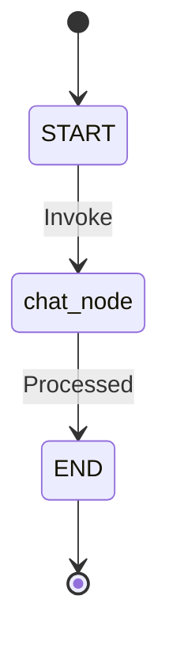
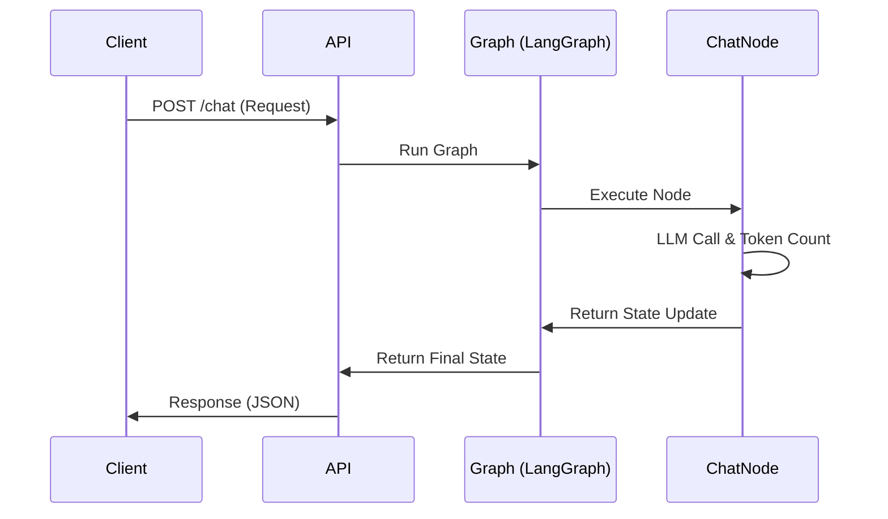
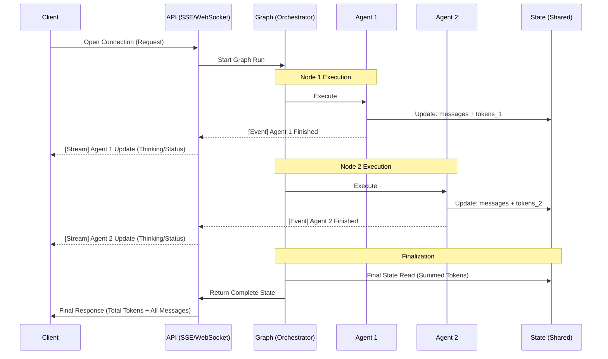
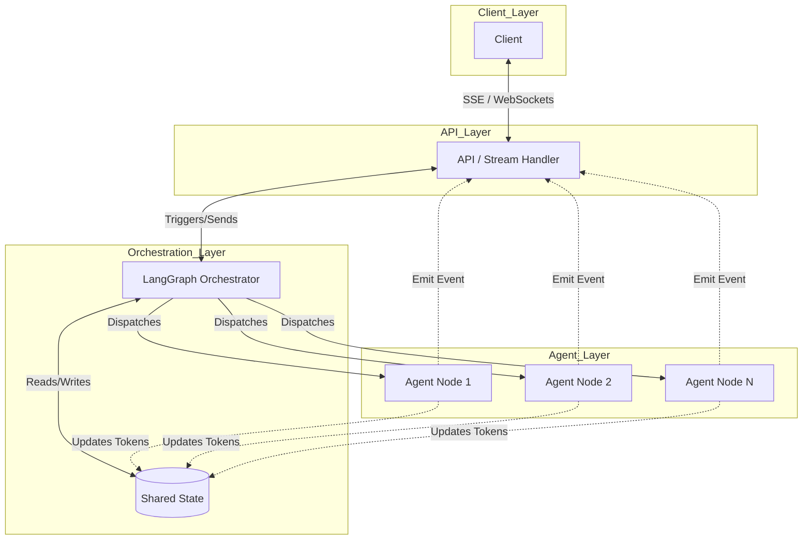

# Architecture Design: Transition from Single-Node to Multi-Agent Streaming Graph

This document describes the current (Ist) state of the backend architecture and the planned (Soll) architecture for implementing complex multi-agent workflows with token aggregation and intermediate streaming.

---

## 1. Current Architecture (Ist-Zustand)

### Overview
The current system is a lightweight backend designed to facilitate basic chat interactions. It utilizes **LangGraph** to manage stateful conversations and **FastAPI** (implied) to serve these interactions via a REST API. At its core, it is a "Single-Agent" system where a single node handles the LLM interaction and returns the result in a single, blocking response.

### Description
- **Graph Structure**: A simple, linear workflow (`START` $\rightarrow$ `chat_node` $\rightarrow$ `END`).
- **State Management**: Uses `PureChatState`, which stores a message list and basic metadata.
- **Communication**: A standard **Request-Response** cycle. The client sends a request and waits (blocks) until the entire graph execution is finished before receiving any data.

### Diagrams

#### State Diagram (Current)
Represents the lifecycle of a single graph execution.


#### Sequence Diagram (Current)
Shows the synchronous flow of a single chat request.


---

## 2. Transition & Implementation Progress

### What is already implemented?
- **Shared State Foundation**: Created `src/shared/states.py` containing `MultiAgentState`. This state is ready to support token aggregation via a custom reducer.
- **LangGraph Core**: The environment is already configured to use `StateGraph` and `Annotated` types, which are essential for the future multi-agent implementation.
- **Modular Node Structure**: The code is organized such that new nodes (Agents) can be added to the `graphs/` directory independently.

---

## 3. Target Architecture (Soll-Zustand)

### Overview
The target architecture moves from a "Single-Response" model to a "Continuous-Stream" model. It allows multiple specialized agents to collaborate on a single task. The client perceives a live, ongoing process where they receive "thinking" updates from each agent, while the total token usage is transparently aggregated in the background.

### Description
- **Multi-Agent Orchestration**: A complex graph containing multiple specialized Agent Nodes.
- **Token Aggregation**: Instead of returning individual token counts, the `State` uses a **Reducer function** to sum up `total_tokens` from every node automatically.
- **Streaming (Non-blocking Updates)**: As each agent completes its step, it updates the State and emits an "Intermediate Event". The backend pushes these events (e.g., via SSE) to the client.
- **Completion Logic**: The client request is only considered "finished" when the graph reaches the `END` node.

### Core State Concept (The Token Reducer)
The aggregation is handled by the `sum_reducer` defined in `src/shared/states.py`:
```python
total_tokens: Annotated[int, sum_reducer]
```

### Diagrams

#### Sequence Diagram (Target: Streaming & Aggregation)
Shows how the client receives updates *during* the execution without the request closing.



#### Communication Diagram (Target: Interaction Flow)
Illustrates the relationship between the components and the flow of information.



#### State Diagram (Target: Multi-Agent Flow)
```mermaid
stateDiagram-v2
    [*] --> START
    START --> Agent_1
    Agent_1 --> Agent_2 : intermediate_event_1
    Agent_2 --> Agent_N : intermediate_event_2
    Agent_N --> END : final_event
    END --> [*]
    
    note right of Agent_1 : Updates State: tokens += n
    note right of Agent_2 : Updates State: tokens += m
```

---

## Summary Table

| Feature | Current (Ist) | Target (Soll) |
| :--- | :--- | :--- |
| **Node Count** | Single Node | Multiple Specialized Agents |
| **Token Handling** | Not tracked/Returned per call | **Aggregated** in State via Reducer |
| **Client UX** | Waiting (Black Box) | **Streaming** (Continuous Feedback) |
| **Request Life** | Ends after one response | Remains **Open** until Graph `END` |
| **Data Transport** | Standard HTTP Response | Streaming (SSE / WebSockets) |
