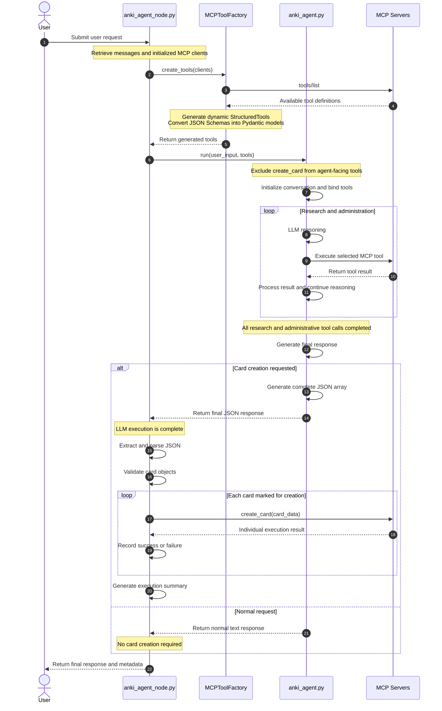

# Anki Agent – Execution Flow

## 1. Overview

The Anki Agent uses a hybrid execution architecture that combines LLM-driven tool execution with deterministic Python-based operations.

The main objective is to preserve the agent's full capabilities for research, information retrieval, and Anki administration while ensuring reliable bulk card creation.

The architecture separates responsibilities between two Python components:

- **`anki_agent_node.py`** – Orchestrates the workflow, initializes dynamic tool discovery, processes the agent response, and executes Anki card creation.
- **`anki_agent.py`** – Handles reasoning, planning, research, dynamic MCP tool execution, and generation of the final card JSON array.

The central design principle is:

**The LLM decides what needs to be done and generates the card data. Python executes the repetitive card creation operations deterministically.**

## 2. Sequence Diagram

The following sequence diagram illustrates the complete execution flow, from receiving the user's request to returning the final execution summary.



## 3. Detailed Execution Steps

### Step 1 – Receiving the User Request

The user submits a request to the Anki Agent.

Examples:

- Create Anki cards from a Nextcloud Collective page.
- Research a technical topic and generate learning cards.
- Retrieve existing Anki cards.
- Create or delete an Anki deck.
- Explain an existing card.
- Search for information in Nextcloud.

The `anki_agent_node.py` receives the request through the LangGraph state.

It retrieves the conversation messages and the initialized MCP clients.

### Step 2 – Dynamic MCP Tool Discovery

The node passes the available MCP clients to the centralized `MCPToolFactory`.

The factory retrieves the available tool definitions from each MCP server using the MCP `tools/list` operation.

The discovered definitions contain information such as:

- Tool name.
- Tool description.
- Input schema.
- Required arguments.
- Optional arguments.

The factory dynamically converts these definitions into LangChain-compatible `StructuredTool` instances.

This means that the agent does not require manually implemented wrappers for individual MCP tools.

### Step 3 – Preparing the Agent Tools

The generated tools are passed to `anki_agent.py`.

Before binding them to the LLM, the agent removes the Anki `create_card` operation from its available tool collection.

All other permitted tools remain available.

This includes:

- Anki deck administration.
- Anki card retrieval.
- Anki metadata operations.
- Nextcloud Collectives.
- Nextcloud page retrieval.
- Nextcloud file operations.
- Firecrawl search.
- Firecrawl scraping and extraction.

**Important:** The exclusion applies exclusively to the agent-facing tool collection. The underlying Anki MCP client remains available to the deterministic execution layer.

### Step 4 – Agent Reasoning and Tool Execution

The agent starts its reasoning loop.

The LLM determines which tools are required to complete the user's request.

It can execute multiple tool calls and use their results for subsequent reasoning.

For example, when generating cards from a Nextcloud page, the agent might:

1. Search for the requested Collective.
2. Retrieve the relevant page.
3. Analyze the page content.
4. Search the web for complementary information.
5. Retrieve available Anki decks.
6. Inspect existing cards to avoid unnecessary duplication.
7. Determine the appropriate deck and note type.
8. Design pedagogically useful cards.

Each tool call is executed through its corresponding dynamically generated `StructuredTool`.

The returned results are added to the conversation as tool messages.

The LLM continues reasoning until it produces a final response without additional tool calls.

### Step 5 – Generating the Final JSON Array

When the user's request involves creating Anki cards, the agent generates one complete JSON array.

Each object represents one card and contains the required properties:

- `isCreatingCard`
- `deck_name`
- `note_type`
- `fields`
- `tags`

The generated JSON is returned as the agent's final response.

At this point, the LLM execution is complete.

No additional LLM-driven tool calls are necessary for creating the cards.

### Step 6 – JSON Parsing and Validation

The `anki_agent_node.py` receives the final agent response.

It extracts and parses the JSON array.

The node validates:

- Whether the response contains a valid JSON array.
- Whether every array entry is an object.
- Whether `isCreatingCard` is a boolean.
- Whether the required card properties exist.
- Whether fields and tags have the expected data types.

Objects with `isCreatingCard: false` are skipped.

Invalid JSON or invalid card structures are reported as execution errors.

### Step 7 – Deterministic Card Creation

After successful validation, the node iterates through the selected card objects.

For every card, it performs one direct MCP operation:

```python
await anki_mcp_client.call_tool(
    "create_card",
    arguments=card_data,
)
```

The special planning property `isCreatingCard` is removed before passing the arguments to the actual creation tool.

The operations are executed sequentially.

The LLM is not involved in this process.

Each operation is handled independently:

- Successful calls increase the success counter.
- Failed calls increase the failure counter.
- Individual failures do not prevent subsequent cards from being processed.

This makes bulk card creation more reliable, particularly when using local language models.

### Step 8 – Result Verification and Reporting

After all card creation operations have been processed, the node generates an execution summary.

The summary contains:

- Number of generated cards.
- Number of cards selected for creation.
- Number of successfully created cards.
- Number of failed cards.
- Number of skipped cards.

The results are returned as an `AIMessage` and stored in the graph metadata.

The reported success count must reflect actual MCP execution results.

## 4. Normal Requests Without Card Creation

The architecture also supports requests that do not involve creating new cards.

For example:

- Explain an existing Anki card.
- Retrieve information from a Collective.
- Search for technical documentation.
- Create a new Anki deck.
- Delete an existing deck.
- Retrieve existing cards.
- Analyze or summarize learning material.

In these situations, the agent returns a normal text response.

The node detects that no card JSON array was returned and skips the deterministic card creation process entirely.

The original agent response is passed back to the graph.

This ensures that card creation is never triggered unnecessarily.

## 5. Error Handling

The architecture distinguishes between three categories of errors.

### 5.1 Agent and Research Errors

Examples:

- MCP server unavailable.
- Nextcloud page cannot be retrieved.
- Firecrawl request fails.
- LLM returns an invalid response.
- Maximum tool iteration count exceeded.

These errors are handled during agent execution and reported to the graph.

### 5.2 JSON Validation Errors

Examples:

- Invalid JSON syntax.
- Missing required properties.
- Incorrect field types.
- Invalid card object structure.

These errors prevent deterministic card creation from starting.

### 5.3 Individual Card Creation Errors

An individual card creation failure does not abort the entire execution loop.

The node records the error and continues processing the remaining cards.

This ensures that one problematic card does not prevent the creation of all other valid cards.

## 6. Architectural Advantages

The separation between LLM reasoning and deterministic execution provides several advantages:

| Advantage | Description |
| :--- | :--- |
| Reliable bulk creation | Cards are created through sequential Python operations rather than repeated LLM tool calls. |
| Full agent capabilities | The agent retains access to all permitted research and administration tools. |
| Local model compatibility | Complex bulk tool-calling sequences are removed from the LLM workflow. |
| Dynamic integration | New MCP tools can become available without manually implementing individual wrappers. |
| Error isolation | Individual card creation failures do not automatically interrupt the remaining operations. |
| Clear responsibilities | Reasoning, planning, tool execution, and deterministic operations remain separated. |
| Extensibility | The architecture can later be reused with other agent frameworks. |

## 7. Core Design Principle

The Anki Agent deliberately separates intelligent decision-making from repetitive execution.

The LLM is responsible for understanding the user's intent, gathering information, combining knowledge sources, selecting appropriate Anki structures, and generating high-quality learning content.

Python is responsible for validating and reliably executing the resulting card creation plan.

**The agent determines what should happen. The deterministic execution layer ensures that it happens reliably.**