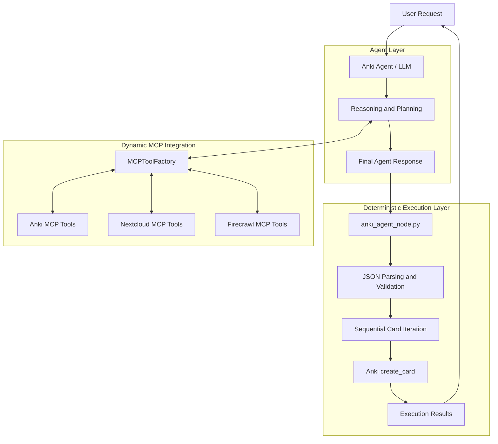
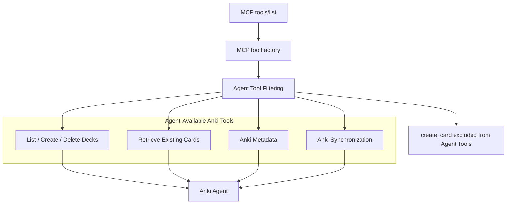
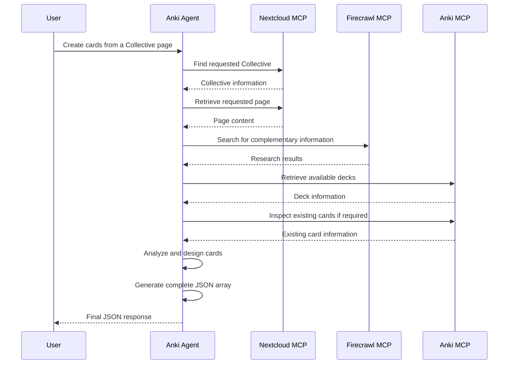
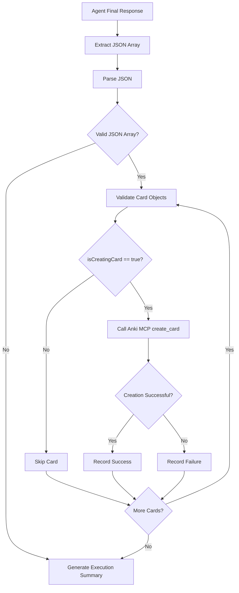
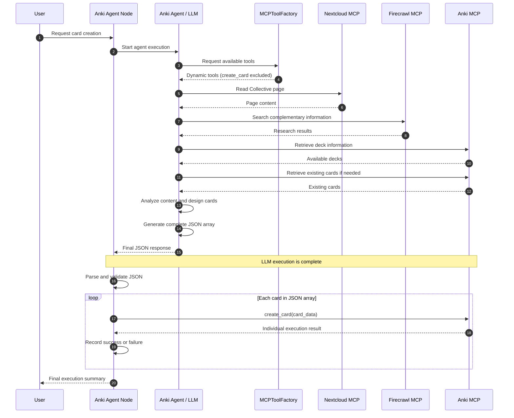

# Anki Agent Architecture

## 1. Overview

The Anki Agent is an action-oriented AI agent for Anki administration, knowledge management, research, and learning content generation.

It combines dynamic MCP tool integration with deterministic execution to provide a reliable workflow, particularly when creating large numbers of Anki cards.

The architecture follows one fundamental principle:

**The LLM is responsible for understanding, researching, planning, and generating structured card data. Python is responsible for reliably executing bulk card creation.**

This separation is particularly important when working with local language models, which can struggle with complex sequences of multiple tool calls.

The agent nevertheless retains its full tool-based capabilities for all other operations.

## 2. Architectural Principles

The architecture follows these principles:

- **Dynamic MCP Integration:** Tools are discovered dynamically from connected MCP servers.
- **Full Agent Capabilities:** The agent can independently use Anki, Nextcloud, and Firecrawl tools for research, analysis, and administration.
- **Deterministic Card Creation:** Anki card creation is deliberately excluded from LLM-driven tool execution.
- **Plan-to-Execute Pattern:** The agent generates a complete JSON array containing all cards to be created.
- **Sequential Execution:** Python processes the generated card objects individually.
- **Error Isolation:** A failed card creation does not prevent subsequent cards from being processed.
- **Framework Independence:** MCP communication remains independent of the agent framework.

## 3. High-Level Architecture

The system consists of three major components:

1. **Agent Layer:** Understands user requests, plans tasks, performs research, and generates card data.
2. **MCP Integration Layer:** Provides dynamically discovered tools from connected MCP servers.
3. **Deterministic Execution Layer:** Validates generated card data and performs individual Anki card creation calls.



## 4. Dynamic MCP Tool Integration

The agent uses the centralized `MCPToolFactory` to obtain its available tools.

The factory discovers tools through the MCP `tools/list` operation and dynamically generates LangChain-compatible `StructuredTool` instances.

The following MCP integrations are available:

| MCP Server | Responsibilities |
| :--- | :--- |
| Anki | Deck administration, card retrieval, note inspection, synchronization, and other Anki operations. |
| Nextcloud | Accessing Collectives, reading pages, searching files, and retrieving knowledge base content. |
| Firecrawl | Web research, searching, scraping, and extracting external information. |

### 4.1 Tool Permission Boundary

The agent receives all permitted tools except the Anki card creation tool.

The `create_card` tool is deliberately excluded from the agent-facing tool collection.

This restriction does not prevent the agent from using other Anki tools.

For example, the agent can still:

- Retrieve available decks.
- Determine the appropriate target deck.
- Create new decks.
- Delete decks when explicitly requested.
- Retrieve existing cards.
- Analyze existing notes and card content.
- Synchronize Anki data.

Only the actual creation of individual cards is delegated to deterministic Python execution.



**Important:** The exclusion of `create_card` is an agent-level restriction. The deterministic execution layer continues to access the same MCP client directly.

## 5. Agent Workflow

The agent is responsible for completing all reasoning and research tasks before generating its final response.

It must not generate card data prematurely if additional information is required.

### 5.1 Research and Information Gathering

The agent can combine multiple MCP servers to complete complex tasks.

Example:

A user requests Anki cards based on a specific Nextcloud Collective page.

The agent performs the following operations:

1. Retrieves the relevant Collective.
2. Locates the requested page.
3. Reads and analyzes the page content.
4. Identifies missing or incomplete information.
5. Performs additional web research using Firecrawl if necessary.
6. Retrieves relevant Anki deck information.
7. Determines the appropriate note type and target deck.
8. Designs pedagogically useful cards.
9. Generates the complete JSON array.

All research and administrative tool calls are completed before the final JSON response.

### 5.2 Research Workflow Diagram



## 6. Plan-to-Execute Pattern: Deterministic Card Creation

Card creation is deliberately separated from LLM-driven tool execution.

Instead of generating individual tool calls, the agent returns one complete JSON array.

The Python node then processes this array independently of the LLM.

### 6.1 JSON Output Contract

Every card object must contain the properties required by the Anki creation tool.

The standard structure is:

```json
[
  {
    "isCreatingCard": true,
    "deck_name": "Biology::Cell_Structure",
    "note_type": "Basic",
    "fields": {
      "Front": "<div>What is the function of the mitochondria?</div>",
      "Back": "<div>The mitochondria produces ATP and plays a central role in cellular energy metabolism.</div>"
    },
    "tags": [
      "biology",
      "cell_structure"
    ]
  },
  {
    "isCreatingCard": true,
    "deck_name": "Biology::Cell_Structure",
    "note_type": "Cloze",
    "fields": {
      "Text": "<div>The {{c1::mitochondria}} is responsible for cellular energy production.</div>"
    },
    "tags": [
      "biology"
    ]
  }
]
```

The JSON array is the final agent output for a card creation request.

The agent does not issue additional tool calls after generating the array.

### 6.2 Deterministic Execution Workflow

The `anki_agent_node.py` performs the following operations:

1. Receives the final agent response.
2. Extracts the JSON array.
3. Parses and validates the JSON.
4. Verifies that the result is a list of card objects.
5. Checks the required card properties.
6. Skips objects where `isCreatingCard` is not `true`.
7. Iterates through the remaining objects.
8. Calls the Anki MCP client's `create_card` operation for each card.
9. Records individual execution results.
10. Returns a final execution summary.

### 6.3 Execution Diagram



### 6.4 Sequential Execution

Card creation is executed sequentially.

The Python node must not delegate the individual card creation calls back to the LLM.

Conceptually, the execution follows this pattern:

```python
created_cards = 0
failed_cards = 0

for card_data in cards:

    if not card_data.get("isCreatingCard"):
        continue

    try:
        await anki_mcp_client.call_tool(
            "create_card",
            arguments=card_data,
        )

        created_cards += 1

    except Exception as exc:
        failed_cards += 1
        print(f"Card creation failed: {exc}")
```

This ensures that every card is handled as an independent operation.

A failure in one operation does not automatically abort the remaining card creation process.

The production implementation should additionally validate tool-level error results, not only Python exceptions, and record enough information to identify failed cards.

## 7. Complete Card Creation Sequence

The following sequence illustrates the complete interaction between the user, agent, MCP servers, and deterministic execution layer.



## 8. Responsibilities of the Main Components

| Component | Responsibility |
| :--- | :--- |
| `anki_agent.py` | LLM initialization, reasoning, dynamic tool usage, research, and JSON generation. |
| `anki_agent_node.py` | Agent orchestration, JSON parsing, validation, deterministic card creation, and execution reporting. |
| `MCPToolFactory` | Dynamic MCP tool discovery, schema conversion, StructuredTool generation, and client-specific routing. |
| `MCPClientInterface` | Standardized MCP client interface, connection lifecycle, discovery, permissions, and execution. |
| `AnkiMCPClient` | Communication with the Anki MCP server. |
| `NextcloudMCPClient` | Communication with the Nextcloud MCP server. |
| `FirecrawlMCPClient` | Communication with the Firecrawl MCP server. |

## 9. Error Handling and Result Verification

The architecture distinguishes between agent execution errors and deterministic execution errors.

### 9.1 Agent Errors

Examples:

- Research tool unavailable.
- Nextcloud page cannot be retrieved.
- Required information is missing.
- Invalid or incomplete JSON output.
- LLM execution fails.

These errors must be reported without pretending that card creation was completed.

### 9.2 Card Creation Errors

Individual card creation failures are handled independently.

The execution layer should record:

- Total number of generated cards.
- Number of cards selected for creation.
- Number of successfully created cards.
- Number of failed cards.
- Details of individual failures.

A failed card must not prevent other valid cards from being processed.

### 9.3 Execution Summary

The node returns a concise result indicating the actual execution outcome.

Example:

```text
Anki card creation completed.

Generated cards: 25
Cards selected for creation: 25
Successfully created: 23
Failed: 2
```

The execution summary must reflect actual MCP execution results rather than merely the number of attempted calls.

## 10. Design Decisions and Future Extensibility

The architecture intentionally avoids requiring local language models to execute long sequences of repetitive tool calls.

This provides several advantages:

- Reduced dependence on reliable LLM tool-calling behavior.
- More predictable bulk card creation.
- Easier error handling and recovery.
- Clear separation between reasoning and execution.
- Full access to dynamic MCP tools for research and administration.
- Compatibility with different LLM providers, including local models.
- Reusability of the MCP integration layer across agent frameworks.

The same pattern can be extended to other bulk operations in the future.

For example, operations that require creating many files, updating multiple records, or executing repetitive API calls can follow the same plan-to-execute architecture.

The central design principle remains:

**Use the LLM for tasks requiring intelligence, context, and decision-making. Use deterministic code for repetitive operations that require reliable execution.**