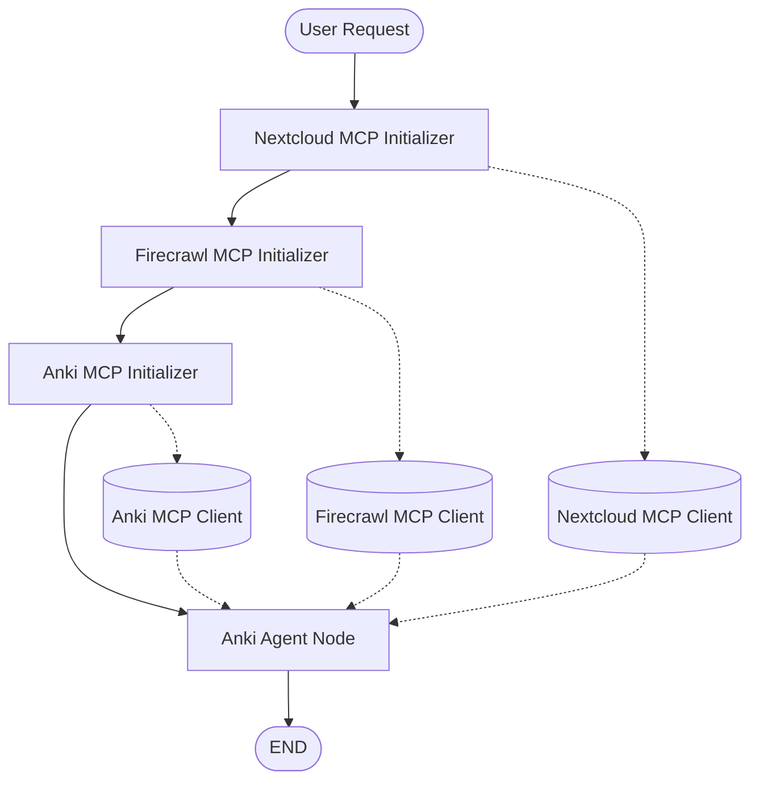

# Anki Graph – Workflow Architecture

## 1. Overview

The Anki Graph coordinates three MCP clients and one central Anki Agent.

Before the agent starts processing a user request, all required MCP clients are initialized. This ensures that the agent has access to the available knowledge sources and Anki functionality throughout its execution.

The workflow is intentionally sequential and uses **LIVE streaming** for the Anki Agent.

## 2. Workflow Diagram

The following diagram provides a quick overview of the complete execution flow.

## 3. Workflow Description

### Step 1 – Nextcloud MCP Initialization

**Node:** `initialize_nextcloud_mcp`

Initializes the connection to the Nextcloud MCP server.

The resulting client is stored in the graph state:

- `nextcloud_mcp_client`

The agent can subsequently use Nextcloud as a knowledge source, for example to search and retrieve Collectives, pages and files.

### Step 2 – Firecrawl MCP Initialization

**Node:** `initialize_firecrawl_mcp`

Initializes the connection to the Firecrawl MCP server.

The resulting client is stored in the graph state:

- `firecrawl_mcp_client`

This provides the agent with web research capabilities, including searching and scraping relevant websites.

### Step 3 – Anki MCP Initialization

**Node:** `initialize_anki_mcp`

Initializes the connection to the Anki MCP server.

The resulting client is stored in the graph state:

- `anki_mcp_client`

The agent can use the available Anki tools to inspect existing decks and cards, retrieve metadata, synchronize data and perform other supported Anki operations.

### Step 4 – Anki Agent Execution

**Node:** `anki_agent`

Once all three MCP clients are initialized, the Anki Agent receives the user request.

The agent can combine all available tools to complete complex tasks.

Typical capabilities include:

- Researching information using Firecrawl.
- Retrieving existing knowledge from Nextcloud.
- Inspecting existing Anki decks and cards.
- Selecting appropriate decks and note types.
- Planning and preparing new Anki cards.
- Executing other supported Anki operations.

The agent uses **LIVE streaming**. Its LLM output and tool-call events are forwarded through the existing `StreamingTranslator`.

### Step 5 – Graph Completion

After the Anki Agent finishes its execution, the graph reaches `END`.

The resulting messages and metadata are returned through the normal graph execution and streaming infrastructure.

## 4. Card Creation – Special Execution Model

Creating Anki cards follows a deliberate separation of responsibilities.

The LLM is responsible for research, planning and generating the card data. The actual `create_card` operation is executed deterministically by Python in `anki_agent_node.py`.

The sequence is:

1. The agent researches the requested topic.
2. The agent retrieves relevant information from Nextcloud and the web.
3. The agent inspects existing Anki content.
4. The agent prepares the final JSON array containing the card definitions.
5. The agent completes its LLM tool-calling loop.
6. Python parses and validates the generated card data.
7. Python executes the `create_card` MCP operation for each valid card.
8. Python records individual successes and failures and reports the result.

The `create_card` operation is excluded from the LLM-facing tool list, but remains available for deterministic execution by Python.

## 5. Architecture Principle

The Anki Graph follows a simple principle:

**Initialize all required services first, then let the agent decide how to use them.**

The graph itself remains intentionally small. Research, reasoning, tool selection and task execution are handled by the Anki Agent, while the graph is responsible for initialization and orchestration.

This keeps the architecture modular and makes it possible to extend the agent with additional MCP services in the future.